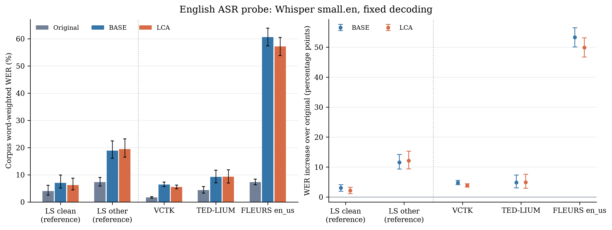

# SCIT Speech 英文跨语料泛化评测报告

2026 年 10 月 28 日  |  三个外部英文语料与 LibriSpeech 参照

**现有模型在 VCTK 和 TED-LIUM 上表现出一定的英文跨语料迁移能力。在 L3、1.5 kbit/s 条件下，LCA 的词错误率分别为 5.55% 和 9.28%。LCA 在 VCTK 上优于 Base，在 TED-LIUM 上基本持平。FLEURS 的主实验词错误率为 57.17%，说明当前模型的跨语料表现仍不均衡。**

本轮实验已在实验室远端主机 lab-suer 的 suer 账户、物理 GPU 1 上完成。评测使用现有 Base 与 LCA 检查点，冻结全部权重，不在外部测试语料上训练、适配或选择模型。报告重点回答模型能否将已有英文语音编码能力迁移到外部语料，以及 LCA 的收益能否保持。

### 评测范围

表 1  数据覆盖与统计单元

| 语料 | 客观评测条数 | WER 条数 | 聚类单元 | 时长 小时 |
| --- | --- | --- | --- | --- |
| VCTK | 2,200 | 2,180 | 110 说话人 | 2.070 |
| TED-LIUM | 1,155 | 1,155 | 11 演讲 | 2.617 |
| FLEURS en_us | 647 | 647 | 350 文本 prompt | 1.774 |
| LS test-clean | 300 | 300 | 40 说话人 | 0.738 |
| LS test-other | 300 | 300 | 33 说话人 | 0.576 |

三个外部语料共 4,002 条录音，另有 LibriSpeech 两个测试子集各 300 条作为参照。主实验合计 4,602 条录音、27,612 组模型与码率组合记录，完成 13,746 次有效 ASR 识别。LS 为 LibriSpeech 的缩写。

VCTK 采用 mic1，每位说话人抽取 20 条，共 110 位说话人；其中包含此前已测的 300 条，新增 1,900 条。p315 的 20 条缺少参考转写，仅参与客观评测，因此 WER 的说话人聚类数为 109。

TED-LIUM 使用固定版本的 release3 test 镜像。1,469 条源记录中，314 条按 ignore_time_segment_in_scoring 标记排除，保留 1,155 条。FLEURS 使用 en_us test 的全部 647 条录音。

数据依据：[PROTOCOL.md](../../experiments/english_generalization_3corpora_20261028_seed42/PROTOCOL.md)；[manifests/summary.json](../../experiments/english_generalization_3corpora_20261028_seed42/manifests/summary.json)；[full/reports/coverage.csv](../../experiments/english_generalization_3corpora_20261028_seed42/full/reports/coverage.csv)。

## 评测设置与主实验结果

模型与码率。Base 使用 SCIT-Speech-Base_best.pt，LCA 使用 SCIT-Speech-LCA_v2_step30000_robust_optimum.pt。模型按原配置严格加载，使用 FP32 推理。一次编码后分别解码 L1、L2、L3 前缀，名义载荷码率为 0.5、1.0、1.5 kbit/s，不含传输开销。L3 为主要工作点，L1/L2 为补充检查；本轮未注入丢包。

统一预处理。整句音频转换为 float32 单声道并重采样至 16 kHz，保留原始幅值。不额外裁剪、按时长筛选或进行时间对齐。客观指标在参考与重建音频的共同长度上计算，并记录两者长度。ASR 使用完整原音与共同长度的 L3 重建音频。

识别设置。固定使用 faster-whisper-small.en，英文模式、beam size 5、temperature 0，关闭 VAD 与前文条件，推理精度为 float16。参考文本与识别文本使用同一固定版本的 Whisper 英文归一化器处理。WER 由全语料替换、删除和插入词数之和除以参考词数计算，不取逐句 WER 的平均值。

指标与不确定性。WER 和 mel-L1 越低越好，STOI、PESQ-WB、SI-SNR 越高越好。95% 区间由 2,000 次聚类 bootstrap 得到，随机种子为 42。VCTK 与 LibriSpeech 按说话人、TED-LIUM 按演讲、FLEURS 按文本 prompt 重采样；模型差异采用配对重采样。

表 2  三个外部英文语料的 L3 词错误率

| 语料 | 原音 WER % | Base WER % | LCA WER % | LCA 的 95% 区间 % |
| --- | --- | --- | --- | --- |
| VCTK | 1.68 | 6.45 | 5.55 | [4.87, 6.20] |
| TED-LIUM | 4.39 | 9.27 | 9.28 | [6.97, 11.85] |
| FLEURS en_us | 7.30 | 60.59 | 57.17 | [53.86, 60.46] |

原音 WER 是同一识别器对未经过编码重建的录音测得的错误率，用于判断编码带来的额外误差。LCA 相对原音的 WER 增量，在 VCTK、TED-LIUM、FLEURS 上分别为 3.87、4.89、49.87 个百分点。这些值应与原音基线共同解读。

VCTK 的 LCA 结果接近 LibriSpeech test-clean 参照的量级；TED-LIUM 中大部分内容仍可被固定识别器识别。FLEURS 的绝对错误率较高，构成本轮跨语料泛化的明显边界。

结果依据：[full/reports/asr_summary.csv](../../experiments/english_generalization_3corpora_20261028_seed42/full/reports/asr_summary.csv)；[full/reports/asr_paired_deltas.csv](../../experiments/english_generalization_3corpora_20261028_seed42/full/reports/asr_paired_deltas.csv)；[PROTOCOL.md](../../experiments/english_generalization_3corpora_20261028_seed42/PROTOCOL.md)。

## 模型比较与 LibriSpeech 参照

图 1  L3 的语料级 WER 与相对原音的 WER 增量。误差棒为 95% 聚类 bootstrap 区间。LS clean 与 LS other 为 LibriSpeech 参照。该图反映自动识别结果，不是人工听测评分。

表 3  LCA 相对 Base 的配对 WER 差异

| 语料 | LCA 减 Base 百分点 | 配对 95% 区间 百分点 |
| --- | --- | --- |
| VCTK | -0.91 | [-1.56, -0.28] |
| TED-LIUM | +0.01 | [-0.28, +0.39] |
| FLEURS en_us | -3.42 | [-5.24, -1.56] |

负值表示 LCA 的 WER 更低。VCTK 的差异为 −0.91 个百分点，区间不跨 0，支持该语料和工作点上的改善。TED-LIUM 的差异仅为 +0.01 个百分点，区间跨 0，尚无明确的 WER 优势证据。FLEURS 虽降低 3.42 个百分点，两模型的绝对错误率仍然较高。

表 4  LibriSpeech 参照结果

| 语料 | 原音 WER % | Base WER % | LCA WER % | LCA 的 95% 区间 % |
| --- | --- | --- | --- | --- |
| LS test-clean | 4.03 | 7.05 | 6.23 | [4.46, 8.73] |
| LS test-other | 7.35 | 18.91 | 19.46 | [16.46, 23.18] |

test-clean 上 LCA 比 Base 降低 0.82 个百分点；test-other 上 LCA 的点估计高 0.55 个百分点，其配对 95% 区间为 [−1.46, +2.86]，不足以确定差异方向。不同语料的原音难度、内容和录音条件同时变化，因此不将跨语料分数差直接解释为单一因素的作用。

结果依据：[full/reports/asr_summary.csv](../../experiments/english_generalization_3corpora_20261028_seed42/full/reports/asr_summary.csv)；[full/reports/asr_paired_deltas.csv](../../experiments/english_generalization_3corpora_20261028_seed42/full/reports/asr_paired_deltas.csv)；[figures/CAPTIONS.md](../../experiments/english_generalization_3corpora_20261028_seed42/figures/CAPTIONS.md)。

## 客观音质与码率检查

表 5  L3 客观指标均值

| 语料 | 模型 | mel-L1 ↓ | STOI ↑ | PESQ-WB ↑ | SI-SNR dB ↑ |
| --- | --- | --- | --- | --- | --- |
| VCTK | Base | 0.9731 | 0.8227 | 2.1177 | 2.2719 |
| VCTK | LCA | 0.9185 | 0.8274 | 2.1070 | 2.0775 |
| TED-LIUM | Base | 0.8964 | 0.8387 | 1.8637 | 1.1404 |
| TED-LIUM | LCA | 0.8505 | 0.8491 | 1.8518 | 0.8493 |
| FLEURS en_us | Base | 1.2919 | 0.6732 | 1.3281 | -14.8050 |
| FLEURS en_us | LCA | 1.3023 | 0.6435 | 1.3182 | -17.0538 |
| LS test-clean | Base | 0.9044 | 0.8857 | 1.9680 | -0.1009 |
| LS test-clean | LCA | 0.8700 | 0.8929 | 1.9600 | 0.0115 |
| LS test-other | Base | 1.0678 | 0.8580 | 1.7711 | -1.6580 |
| LS test-other | LCA | 1.0328 | 0.8647 | 1.7595 | -1.5131 |

VCTK 与 TED-LIUM 上，LCA 的 mel-L1 和 STOI 优于 Base，PESQ-WB 与 SI-SNR 的均值略低。FLEURS 上，LCA 的四项客观指标均弱于 Base，但 WER 较低。各指标反映的性能侧面不同，不能将单项改善等同于音质全面提升。

表 6  不同码率的 mel-L1 配对差值

| 语料 | L1  0.5 kbit/s | L2  1.0 kbit/s | L3  1.5 kbit/s |
| --- | --- | --- | --- |
| VCTK | +0.2504 | +0.0309 | -0.0547 |
| TED-LIUM | -0.0447 | -0.0393 | -0.0459 |
| FLEURS en_us | +0.0394 | +0.0563 | +0.0104 |

表 6 均为 LCA 减 Base，负值表示 LCA 更好。VCTK 在 L1/L2 上出现 mel-L1 退化，到 L3 才改善；TED-LIUM 三个工作点均改善；FLEURS 三个工作点均未改善。因此，L3 的优势不能外推到所有码率。本轮 L1/L2 未运行 ASR，不能据此推断其 WER。

TED-LIUM 的 ted_00769 在两模型、三个工作点下均无法计算 PESQ，共 6 个失败条目。各 TED-LIUM PESQ 分组的有效样本数为 1,154，其他指标为 1,155。失败项保留在记录中，未补零。所有具有参考文本的 ASR 样本均已完成。

结果依据：[full/reports/objective_summary.csv](../../experiments/english_generalization_3corpora_20261028_seed42/full/reports/objective_summary.csv)；[full/reports/objective_paired_deltas.csv](../../experiments/english_generalization_3corpora_20261028_seed42/full/reports/objective_paired_deltas.csv)；[full/reports/metric_failures.csv](../../experiments/english_generalization_3corpora_20261028_seed42/full/reports/metric_failures.csv)。

## 结论与证据范围

**本轮完成了三个外部英文语料的冻结模型评测。结果支持模型在 VCTK 和 TED-LIUM 上具有一定的跨语料迁移能力，其中 LCA 在 VCTK 的 L3 词错误率上有明确改善，TED-LIUM 的词错误率与 Base 基本持平。FLEURS 的主实验结果明显退化，说明泛化表现依赖具体语料条件。**

LCA 的收益具有指标和码率边界。其在 VCTK、TED-LIUM 的 L3 mel-L1 与 STOI 上取得改善，但 PESQ-WB、SI-SNR 并未同步提升；VCTK 的低码率 mel-L1 也未保持 L3 的优势。当前证据适合支持“部分外部英文语料与工作点上的迁移及改进”，尚不足以支持“所有英文语料或码率下全面领先”。

### 统计与数据边界

统计区间来自同一对现有训练种子的检查点，反映评测样本变化，不包含重复训练造成的波动。多语料、多指标比较未进行多重比较校正。TED-LIUM 仅有 11 个演讲聚类；FLEURS 缺少说话人标识，采用 350 个文本 prompt 聚类，不能据此声称控制了说话人相关性。

已检查 Base 与 LCA 的训练、验证清单：各含 27,039 条训练记录、1,500 条验证记录，未发现与本轮测试重叠的样本 ID，也未发现三个外部语料的路径记录。该检查范围限于现有清单，不构成对全部预训练数据的完整去污染证明。ASR 与其他预训练组件的语料暴露情况尚未建立。

WER 来自固定自动识别器，客观音质指标也不能替代人工听测。本轮未引入丢包或开展新的主观质量评估，相关通信鲁棒性与感知质量结论需由对应实验支持。所有跨语料比较均使用本轮一致的运行环境，未混入历史评测分数。

### 结果追溯

实验根目录为 output/experiments/english_generalization_3corpora_20261028_seed42。完整远端记录保存在 /home/suer/english_generalization_20261028。以下路径均相对实验根目录。

协议与样本：PROTOCOL.md、RUNBOOK.md、manifests/all_samples.jsonl。

主结果：full/objective.jsonl、full/asr.jsonl，以及 full/reports 下的统计汇总、配对差异、覆盖率和失败记录。

复现证据：provenance/training_manifest_audit.json、provenance/source_hashes.json、full/objective_identity.json、full/asr_identity.json。

完成核验：checks/final_validation.json 记录主实验与补充对照的聚合结果重算通过。本报告中的表格直接从归档 CSV 生成，并按逐条识别记录与客观结果校验。

## 附录 FLEURS 输入增益对照

此项为观察主实验结果后设计的补充对照，覆盖 FLEURS 全部 647 条录音。它采用独立预处理条件，结果与正文主实验分别报告，不替代主实验估计，也不属于预先设计的独立确认实验。

对每条录音施加恒定增益，目标 RMS 为 −25 dBFS，峰值上限为 0.99。6 条录音因峰值限制未达到目标 RMS。模型、参考文本与评分方式保持一致，无权重更新、去噪或按效果筛除样本。

表 A1  FLEURS 补充对照的 L3 结果

| 条件 | 原音 WER % | Base WER % | LCA WER % | LCA STOI |
| --- | --- | --- | --- | --- |
| 主实验 | 7.30 | 60.59 | 57.17 | 0.6435 |
| 增益对照 | 7.25 | 15.53 | 13.98 | 0.8141 |

增益对照下，LCA 的 WER 为 13.98%，95% 区间为 [12.73%, 15.45%]。与主实验同样本配对比较，WER 降低 43.19 个百分点，95% 区间为 [40.05, 46.41]。原音 WER 从 7.30% 变为 7.25%，基本不变；LCA 相对原音仍增加 6.73 个百分点。

对应 LCA 客观指标为 mel-L1 0.8268、STOI 0.8141、PESQ-WB 1.8162、SI-SNR 1.5627 dB。这组结果表明评测表现会随输入处理条件变化，其作用范围限于本次补充对照。

补充对照依据：[level_control/CONTROL_PROTOCOL.json](../../experiments/english_generalization_3corpora_20261028_seed42/level_control/CONTROL_PROTOCOL.json)；[level_control/full/reports/asr_summary.csv](../../experiments/english_generalization_3corpora_20261028_seed42/level_control/full/reports/asr_summary.csv)；[level_control/full/reports/objective_summary.csv](../../experiments/english_generalization_3corpora_20261028_seed42/level_control/full/reports/objective_summary.csv)；[analysis/fleurs_level_control_paired.json](../../experiments/english_generalization_3corpora_20261028_seed42/analysis/fleurs_level_control_paired.json)。

### 检查点与运行标识

Base 检查点 SHA256

`8c23c2b146575d1144b7f2f96e6ded88aa44cd89cf53fa75ab14ff6e279763e6`

LCA 检查点 SHA256

`af60223b2f44733f5a43d5a022871dad061dfe2421473c96f5d350c3d4b49a5a`

主实验样本清单 SHA256

`de007738841b5f87915d856964d6ceef39c58c2d2277c458e9a564b9e20651a1`

运行记录：Python 3.10.20，PyTorch 2.10.0，torchaudio 2.10.0+cu128，faster-whisper 1.2.1。数据版本、ASR 模型版本、文本归一化器版本、完整依赖与源代码哈希均见原始实验归档。
